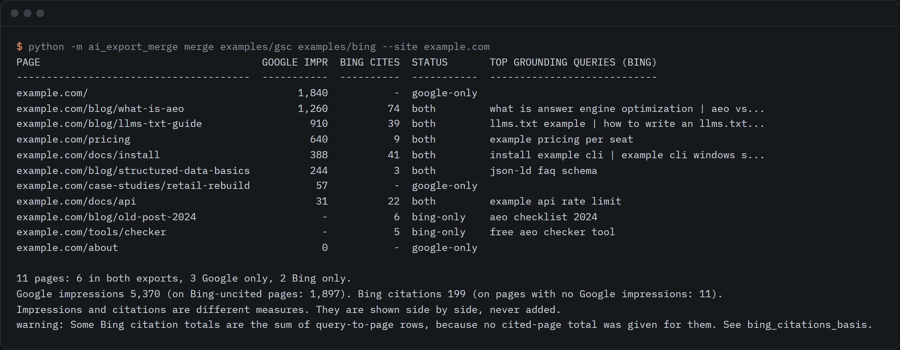

# ai-export-merge

Joins your Search Console generative AI export and Bing AI Performance export into one per-page table, locally.



```sh
python -m ai_export_merge merge gsc-export/ bing-export/ --site example.com
```

The screenshot is a real run on the synthetic files in `examples/`. Python 3.10 or newer, standard library only, no network access.

## Why this exists

Both search engines now report how your pages show up in AI answers, and each report lives in its own console.

- Google added generative AI performance reports to Search Console in June 2026. They show impressions in AI Overviews and AI Mode, by page, country, date and device, and have an export button. ([Google Search Central blog, June 2026](https://developers.google.com/search/blog/2026/06/gen-ai-performance-reports); [help page, read 2026-09-30](https://support.google.com/webmasters/answer/16984139))
- Bing added an AI Performance report to Bing Webmaster Tools on 10 February 2026. It shows citations, the grounding queries behind them, and citation activity per page. ([Bing Webmaster blog, February 2026](https://blogs.bing.com/webmaster/February-2026/Introducing-AI-Performance-in-Bing-Webmaster-Tools-Public-Preview); [spreadsheet export noted by Practical Ecommerce, read 2026-09-30](https://www.practicalecommerce.com/bings-improved-ai-performance-section))

The two exports do not share a format, and neither carries what the other one has. Google gives impressions and no queries. Bing gives citations and queries and no Google numbers. On 2026-09-30 a search of GitHub, npm and the web found no tool that joins them (one 0-star Codex skill for the Google report, and general SEO reporting apps that read other data). This one does the join, on your machine, so the exports never leave it.

## Use it

Export the page table from Search Console and the AI Performance data from Bing Webmaster Tools, then point the tool at the files. Each argument can be a `.csv` or `.xlsx` file, a `.zip`, or a folder.

```sh
# install from GitHub, or run from a clone
pip install git+https://github.com/reidifydesign/ai-export-merge

# join them and look at the result
python -m ai_export_merge merge gsc-export/ bing-export/ --site example.com

# save every page as CSV, JSON or Markdown (format comes from the extension)
python -m ai_export_merge merge gsc-export/ bing-export/ -o merged.csv

# check what the tool found in your files, without merging
python -m ai_export_merge inspect gsc-export/ bing-export/
```

Bing can give you more than one file (cited pages, grounding queries, a query-to-page table). Pass them all, or the folder holding them.

| Option | What it does |
|---|---|
| `--site example.com` | Keeps one host and gives relative paths like `/pricing` a host. Without it, hosts are joined as they are, and a warning lists them if there is more than one. |
| `--format table\|csv\|json\|md` | Output format. Default is a table on screen, or the format of the `-o` file. |
| `--sort impressions\|citations\|status\|url` | Row order. Default `impressions`. |
| `--limit N` | Rows in the on-screen table (default 25, `0` for all). Files always get every row. |
| `--top-queries N` | Grounding queries kept per page (default 5). |
| `--gsc-col ROLE=HEADER`, `--bing-col ROLE=HEADER` | Name a column by hand. Roles: `page`, `query`, `impressions`, `citations`, `share`, `date`, `country`, `device`. |
| `--gsc-table TEXT`, `--bing-table TEXT` | Use only tables whose name contains the text. |

### What comes out

One row per page, with:

| Field | Meaning |
|---|---|
| `url` | The page, as first written in the files |
| `status` | `both`, `google-only` or `bing-only` |
| `gsc_impressions` | Google AI impressions. Empty when Google's file does not list the page |
| `bing_citations` | Bing citations. Empty when Bing's files do not list the page |
| `bing_citations_basis` | `page-table` if the number comes from a cited-page table, `sum-of-query-rows` if it was added up from query-to-page rows |
| `bing_grounding_queries` | How many grounding queries Bing ties to the page |
| `top_grounding_queries` | The top queries by citations, joined with ` \| ` |

JSON output adds a summary, the warnings, and any grounding queries that have no page in the files.

### How pages are matched

Two URLs are the same page when they agree after these changes: scheme and fragment are ignored, `www.` is ignored, a trailing slash is ignored, percent-encoding is decoded, and tracking parameters (`utm_*`, `gclid`, `fbclid`, `msclkid` and a few more) are dropped. Other query parameters are kept, sorted. Path case is kept, because paths are case-sensitive. Rows for the same page are summed.

## What it does not do

- **It does not add or compare the two numbers.** An impression is something Google showed. A citation is something Bing used in an answer. They are different things from different systems, so the table puts them side by side and never adds them or works out a ratio.
- **Google's report has no queries and no clicks.** The queries in the table come from Bing only, and describe Bing and its partners, not Google.
- **It does not fetch anything.** There is no API step. Google's generative AI report is reported to be export-by-hand only ([a practitioner's write-up](https://chudi.dev/blog/search-console-generative-ai-report), not checked by us), and Bing's export is a button in the console.
- **Columns are found by name, and the real names are unconfirmed.** Neither vendor documents the column headers of its export. [[CONFIRM: exact column headers and sheet names of a real Search Console generative AI export and a real Bing AI Performance export]] The tool matches common names (`Page`, `Top pages`, `URL`, `Impressions`, `Citations`, `Grounding query` and similar, ignoring case and punctuation). If your headers differ, `inspect` shows what was found and `--gsc-col` or `--bing-col` fixes it. If you have a real header set that fails, open an issue with the header row only.
- **Only a table with a page column can be joined.** Google's country, device and date tables have no page column, so they are skipped and listed by `inspect`.
- **Cells of `~` or `-` count as 0.** Google's help page says these become zeros in downloaded files.
- **The exports are new and may change.** Google's report has existed since June 2026 and Bing's public preview since February 2026. Expect format changes.
- **The example files are invented.** They are for an imaginary site, and their headers are illustrative.

## Development

```sh
python -m unittest discover -s tests
```

## Licence

MIT. Built by [@rishsadh](https://github.com/rishsadh) at [Reidify](https://reidify.design).
